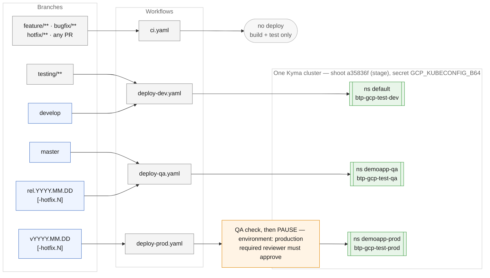
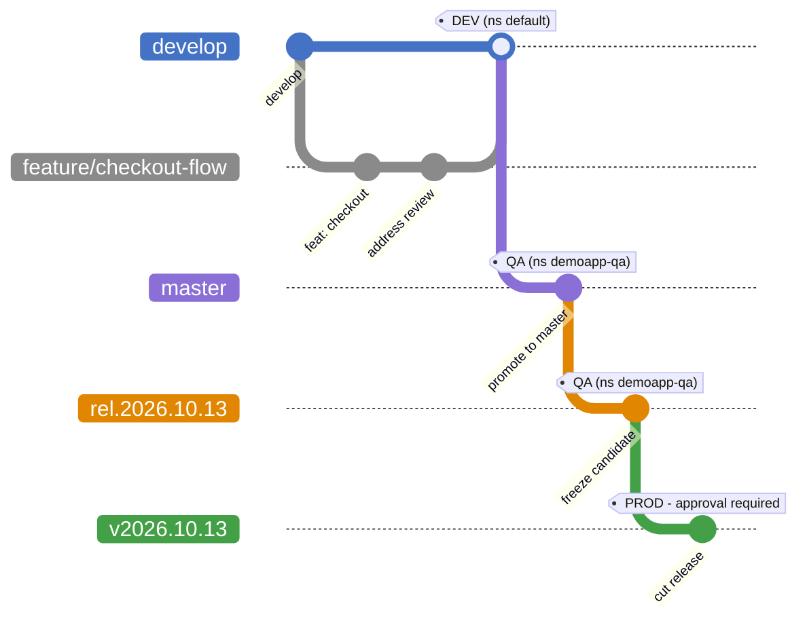
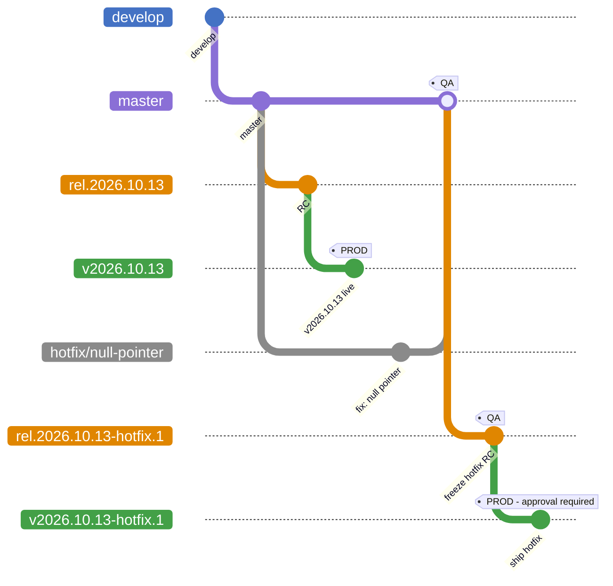
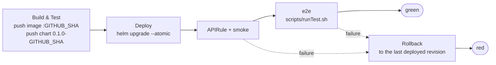

# Branching strategy

How a change travels from a topic branch to production in this repository, and what
each branch name causes to happen. 

## The contract

| Branch | Workflow | Environment | Namespace | Image repository | Gate |
|---|---|---|---|---|---|
| `feature/**`, `bugfix/**`, `hotfix/**`, any PR | `ci.yaml` | none | — | — | build + test only, never deploys |
| `develop` | `deploy-dev.yaml` | dev | `default` | `btp-gcp-test-dev` | none |
| `testing/**` | `deploy-dev.yaml` | dev | `default` | `btp-gcp-test-dev` | none |
| `master` | `deploy-qa.yaml` | qa | `demoapp-qa` | `btp-gcp-test-qa` | none |
| `rel.YYYY.MM.DD[-hotfix.N]` | `deploy-qa.yaml` | qa | `demoapp-qa` | `btp-gcp-test-qa` | none |
| `vYYYY.MM.DD[-hotfix.N]` | `deploy-prod.yaml` | prod | `demoapp-prod` | `btp-gcp-test-prod` | this commit passed QA, then `production` environment, required reviewer |

All three environments live in **one** Kyma cluster — shoot `a35836f`, stage — reached
with a single `GCP_KUBECONFIG_B64` secret. They are separated by namespace, not by
subaccount.

Every dev and QA build also publishes the Helm chart to
`oci://gtlc-production.common.repositories.cloud.sap/btp-gcp-test-charts/demoapp`, as
version `<Chart.yaml version>-<commit>`. Prod doesn't publish; the chart for that commit was
already published by its QA build. See [Artifacts](#artifacts).

All PRs are raised and merged in the GitHub web UI, always with **Create a merge commit**.



## Scenario 1 — everyday feature work

The normal path. A topic branch off `develop`, a PR, then promotion through each
environment. Nothing reaches production without passing through QA twice: once from
`master`, once from the frozen release candidate.



1. Branch from `develop` as `feature/<name>`. Pushing it runs `ci.yaml`: tests, shell
   syntax, `helm lint` and `helm template` for all three environments, and a Docker
   build that is **not** pushed. Nothing deploys.
2. Open a PR into `develop`. The same `ci.yaml` runs.
3. Merge. `deploy-dev.yaml` builds and pushes the image and chart, deploys to namespace
   `default`, and runs e2e.
4. Raise a PR from `develop` into `master` and merge it. `deploy-qa.yaml` does the same
   for `demoapp-qa`.
5. Freeze a release candidate. Branch `rel.2026.10.13` from the latest `master` and push it:

   ```bash
   git switch master
   git pull --ff-only origin master
   git switch -c rel.2026.10.13
   git push -u origin rel.2026.10.13
   ```

   QA redeploys from the frozen branch and runs e2e. Later pushes to `master` redeploy QA
   too, but the release gate checks this commit's own QA run, so that doesn't affect the
   release.
6. Promote it. Once the `rel.*` QA run is green, branch `v2026.10.13` from the remote
   release candidate and push it:

   ```bash
   git fetch origin
   git switch -c v2026.10.13 origin/rel.2026.10.13
   git push -u origin v2026.10.13
   ```

   `deploy-prod.yaml` checks that this commit passed QA, then **waits** for a reviewer on
   the `production` environment. If you push it before the `rel.*` run has finished, the
   check fails; re-run the prod run once QA is green.
7. If any commits were added to the release branch, raise PRs from it into `master` and
   `develop` and merge them. Keep the `rel.*` and `v*` branches.

Branch names must match exactly, or no deploy starts: `rel.YYYY.MM.DD` and
`vYYYY.MM.DD`, with an optional `-hotfix.N` on both.

## Scenario 2 — hotfix on a released version

Hotfixes reuse the same branch shapes with a `-hotfix.N` suffix. The fix goes to
`master` first so it is never lost, then follows the same QA-then-prod path. The hotfix
candidate is cut from `master`, so any unreleased work on `master` ships with it.



Branch `hotfix/<name>` from `master`, raise a PR into `master` and merge it. After the
fix is merged to `master`, cut the hotfix release candidate. This deploys to QA:

```bash
git switch master
git pull --ff-only origin master
git switch -c rel.2026.10.13-hotfix.1
git push -u origin rel.2026.10.13-hotfix.1
```

Once that QA run is green, cut the hotfix release. This deploys to prod after the QA check and approval:

```bash
git fetch origin
git switch -c v2026.10.13-hotfix.1 origin/rel.2026.10.13-hotfix.1
git push -u origin v2026.10.13-hotfix.1
```

Then raise a PR from `master` into `develop` and merge it, keeping both branches, so the
next release keeps the fix.

## Scenario 3 — experimental work on the dev cluster

`testing/**` branches deploy to dev exactly as `develop` does. This is a deliberate
escape hatch for trying something on a real cluster without merging it.

Two consequences worth knowing:

- `testing/**` and `develop` share namespace `default` and the Helm release name
  `hello-world`. **They overwrite each other.** Pushing `testing/foo` replaces whatever
  `develop` last deployed, and the next push to `develop` replaces it back.
- A second push waits for the running deploy to finish, so e2e or rollback is never
  cancelled halfway.

Use a `testing/**` branch when you want the dev cluster to yourself for a moment, and
tell whoever else is using dev.

## Scenario 4 — what a deploy does

Dev and QA share `wf-deploy-e2e.yaml`:



| Step that fails | What happens to the running service |
|---|---|
| Tests, placeholder check, image build, chart publish | Nothing deployed yet. Previous release untouched. |
| `helm upgrade --atomic` | Helm reverts automatically. |
| APIRule wait, smoke test or e2e | Automatic rollback, then the run goes red. |

The e2e suite is a Postman collection, `e2e/demoapp.postman_collection.json`, run by Newman
against the public URL. It follows the FIPC `e2e-test` pattern, and exits 99 when tests fail.
Results are uploaded as a run artifact. Any failure in the e2e job triggers a rollback,
including one that isn't a test failure, such as Newman failing to install.

On a first-ever deploy there's nothing to roll back to, so the release stays up for debugging.

A rollback only restores the cluster. If the bad commit reached `develop` or `master`, it
stays there until someone reverts it, and later deploys from that branch fail and roll back
until they do. To test this, follow test 4 in [demo-runbook.md](demo-runbook.md).

**What a rollback uses.** It doesn't need the repo chart or the published chart:

1. Every `helm upgrade` stores that revision's rendered manifests and values as a Secret in
   the namespace, named `sh.helm.release.v1.hello-world.v<N>`.
2. `helm rollback` re-applies the stored manifests of the last `deployed` revision, as a
   new revision described as `Rollback to <N>`.
3. Those manifests reference the old image tag, so Kubernetes pulls
   `btp-gcp-test-<env>:<old commit>` from Artifactory again.

So two things must still exist: the revision Secret (Helm keeps the last 10 per release)
and the old image in Artifactory. If a cleanup policy deleted the image, the rollback fails
with `ImagePullBackOff` and the run shows it.

Prod (`deploy-prod.yaml`) has no e2e and no automatic rollback:

1. **QA gate:** this commit must have a successful `deploy-qa.yaml` run on the matching
   `rel.*` branch. A run that rolled back counts as failed. There's no override.
2. **Approval:** a reviewer approves on the `production` environment.
3. **Deploy:** the image QA tested is copied to the prod repository, not rebuilt, then
   deployed and smoke tested.

If a prod smoke test fails, a person decides whether to roll back:

```bash
helm history hello-world -n demoapp-prod
helm rollback hello-world <revision> -n demoapp-prod --wait
```

## Scenario 5 — a PR that is never merged

`ci.yaml` runs on every PR into `develop`, `master`, or a `rel.*` branch, and on every
push to `feature/**`, `bugfix/**` and `hotfix/**`. It runs tests, `bash -n` over the
scripts, `helm lint` plus `helm template` for all three environments, and a Docker build
with `push: false`.

No registry login, no cluster credentials, no deploy. A PR cannot publish an image or a
chart, or touch a namespace, by construction.

## Artifacts

All in Artifactory at `gtlc-production.common.repositories.cloud.sap`:

| Artifact | Published by | Repository | Version |
|---|---|---|---|
| Image | dev and QA Build & Test | `btp-gcp-test-dev`, `btp-gcp-test-qa` | `<commit>` |
| Image | prod, a copy of the QA image | `btp-gcp-test-prod` | `<commit>` |
| Helm chart | dev and QA Build & Test | `btp-gcp-test-charts/demoapp` (OCI) | `<Chart.yaml version>-<commit>` |

Deploys install the chart from the repo. The published chart records exactly what each
commit shipped. To get it:

```bash
helm registry login gtlc-production.common.repositories.cloud.sap
helm pull oci://gtlc-production.common.repositories.cloud.sap/btp-gcp-test-charts/demoapp \
  --version 0.1.0-<commit>
```

To change where charts go, edit `CHART_REPO` in `.github/workflows/wf-deploy-e2e.yaml`. When
you change the chart, bump `version` in `helm/demoapp/Chart.yaml`.

## Reference

### Triggers, exactly as written

```yaml
# ci.yaml
pull_request: [develop, master, 'rel.*']
push:         ['feature/**', 'bugfix/**', 'hotfix/**']

# deploy-dev.yaml
push: [develop, 'testing/**']

# deploy-qa.yaml
push: [master, 'rel.[0-9][0-9][0-9][0-9].[0-9][0-9].[0-9][0-9]',
               'rel.[0-9][0-9][0-9][0-9].[0-9][0-9].[0-9][0-9]-hotfix.[0-9]*']

# deploy-prod.yaml
push: ['v[0-9][0-9][0-9][0-9].[0-9][0-9].[0-9][0-9]',
       'v[0-9][0-9][0-9][0-9].[0-9][0-9].[0-9][0-9]-hotfix.[0-9]*']
```

